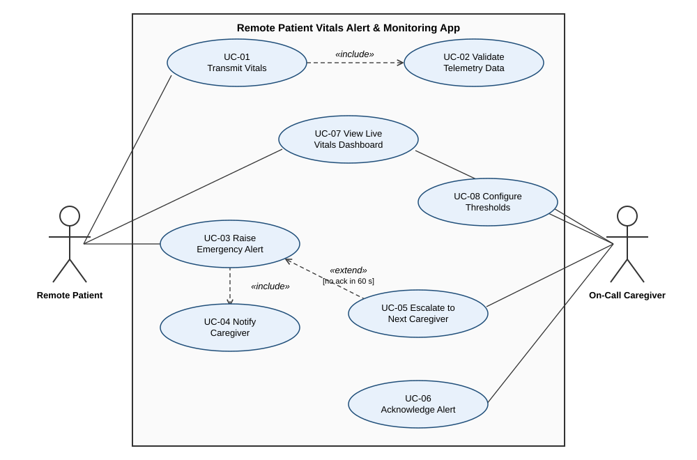

# Lab 1: Requirements Engineering & UML Use-Case Modelling
**PES University – Dept. of CSE**
**Problem Statement #16 – Healthcare & Telemedicine: Remote Patient Vitals Alert & Monitoring App**

| Field | Value |
|---|---|
| Name | _<your name>_ |
| SRN | _<your SRN>_ |
| Section | _<your section>_ |

## Problem Overview
A continuous monitoring pipeline for post-operative patients that ingests vital telemetry (SpO2, Heart Rate, BP), detects threshold breaches, and escalates emergency alerts through a caregiver matrix.

**Actors:** Remote Patient, On-Call Caregiver

## Repository Structure
```
.
├── README.md
├── requirements/
│   └── requirements.md            # 5 FRs + 2 NFRs, traceability
├── diagrams/
│   ├── use-case-diagram.puml      # PlantUML source
│   └── use-case-diagram.svg       # rendered diagram
└── use-case-spec/
    └── UC-03_Raise_Emergency_Alert.md   # 1-page flow specification
```

## Deliverables
1. [Requirements Table](requirements/requirements.md): FR-001 to FR-005, NFR-001, NFR-002
2. [UML Use-Case Diagram](diagrams/use-case-diagram.svg): 2 actors, 8 use cases, 2 `«include»`, 1 `«extend»`
3. [Use-Case Flow Specification](use-case-spec/UC-03_Raise_Emergency_Alert.md)


